<h1 align="center">HELLO WORLD, eu sou o Leonardo 👋</h1>

  <code>Gelane-Dev@github ~ $ ./contributions.sh</code>

  

  <code>Gelane-Dev@github ~ $ whoami</code>

  
  

---

### 🗂️ Projetos em destaque

| Endpoint | Projeto | Stack |
| --- | --- | --- |
| `GET /projetos/emporio` | **[Empório da Música — AI Assistant](https://github.com/gelane-dev/emporio-da-musica-agent)** Assistente virtual Mel com arquitetura de agentes e *Function Calling*: responde dúvidas, consulta o catálogo e aplica regras de negócio. | Python · FastAPI · React · LLMs |
| `GET /projetos/ecommerce` | **[E-commerce Full Stack](https://github.com/gelane-dev/ecommerce-fullstack)** Autenticação JWT, permissões por perfil, produtos e pedidos com regras de estoque. Frontend em fase inicial. | FastAPI · PostgreSQL · SQLAlchemy · React |
| `GET /projetos/fitflow` | **[FitFlow — Gestão de Treinos](https://github.com/gelane-dev/FitFlow)** Acompanhamento de treinos integrando API, persistência e app mobile. | FastAPI · PostgreSQL · React Native |
| `GET /projetos/clientes` | **[projeto_cadastro_cliente](https://github.com/gelane-dev/projeto_cadastro_cliente)** CRUD de clientes em evolução. | Flask · SQLite |
| `GET /projetos/facial` | **[facial-recognition](https://github.com/gelane-dev/facial-recognition)** Reconhecimento facial, em desenvolvimento. | OpenCV · DeepFace · SQLite |
| `GET /projetos/carrinho` | **[carrinho-de-compras](https://github.com/gelane-dev/carrinho-de-compras)** Projeto da faculdade de ADS. | HTML · CSS · JavaScript |

---

### 📫 Como me encontrar

  
  
  
  

